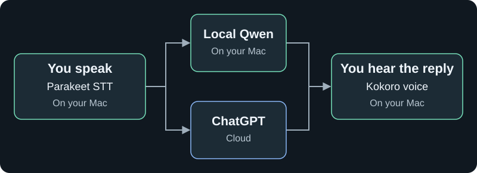

# 🎙️ Local Voice

**Talk to AI on your Mac. Interrupt naturally. Keep speech processing local.**

A native SwiftUI app with live transcripts, local voices, and your choice of a local LLM or ChatGPT. No Python, Ollama, or API key required.

## How it works

Speak over a reply to stop it. Your microphone stays active during playback.

## 🚀 Get started

**Requires:** Apple Silicon, macOS 27.2+, and Xcode with the Metal Toolchain. Tested on an M3 MacBook Air with 24 GB memory.

1. Clone this repository and open `realtime-voice-llm-local.xcodeproj` in Xcode.
2. Select your signing team and **My Mac**. Use a **Release** build for faster local inference.
3. Run the app. First launch downloads the required models and prepares local speech; allow a few minutes.
4. Click **Start call**, allow microphone access, and speak English.

Missing Metal Toolchain?

Run `xcodebuild -downloadComponent MetalToolchain`, then build again. Xcode may also ask you to trust Apple's MLX package plugin.

## 🧠 Choose your AI

| | Local Qwen | ChatGPT |
|---|---|---|
| Model | Qwen3.5 4B, 4-bit | Models available to your account |
| Runs | On your Mac | At OpenAI |
| Sign-in | Not needed | **Continue with ChatGPT** in settings |
| Offline | Yes, after downloads, with web search off | No |
| Speech recognition & voice | Local | Local |

ChatGPT uses your eligible plan through [Sign in with ChatGPT](https://developers.openai.com/siwc/token-sharing-open-source). Plan limits apply. Changing provider, account, or model starts a new conversation.

## Make it your own

| Setting | What it does |
|---|---|
| **Reasoning level** | Choose lighter or deeper thinking. GPT-6-Luna includes **None**; **Model default** is a separate choice. |
| **Prepare while I speak · Balanced** | ChatGPT prepares silent drafts from stable phrases, then checks your final words before replying. May reduce waiting and use extra allowance. |
| **Web search** | Use app tools for DuckDuckGo, page reading, and weather, or test and select the model's built-in search. |
| **Voice & speed** | Pick from four voices and adjust speaking speed. |
| **Pause before replying** | Allow more time to finish your thought. |
| **Echo cancellation** | Keep enabled with speakers; optional with headphones. |

Also includes mute, typed messages, copy transcript, and local calculator/time tools. Search tests use your ChatGPT allowance and end any active call.

## 🎧 Speech recognition

**STT (speech-to-text): Parakeet Realtime EOU 120M**, running locally through FluidAudio / Core ML with 160 ms streaming chunks. The current app supports English speech. Silero VAD detects when you are speaking; Kokoro handles text-to-speech.

**Known limitation:** transcription is not yet accurate enough for consistently reliable conversations. It can mishear words and affect the AI's answer. The AI uses context to interpret likely mistakes, but cannot always correct them. Check the live transcript and repeat or type your message when needed.

## 🔒 Privacy

- Microphone audio stays on your Mac and is not recorded during normal calls.
- ChatGPT receives conversation text and tool results. Web tools contact their respective services.
- Credentials stay in macOS Keychain. Conversations stay in memory until cleared or the app quits.
- No shell or file-access tools are exposed to the AI.

## Quick fixes

| Problem | Try this |
|---|---|
| Empty microphone meter | Open the MacBook lid, check microphone permission and macOS Sound settings. |
| Wrong audio device | Select the device in macOS Sound settings, then restart the call. |
| Replies too early | Increase **Pause before replying**. |
| Slow replies | Try lower reasoning or Balanced preparation. Web lookups can add delay. |

🛠️ Developer notes

**Stack:** SwiftUI · MLX Qwen · Parakeet 120M · Silero VAD · Kokoro 82M · AVAudioEngine

**Tests:** Run the unit test target in Xcode. The Release build and 40 tests passed on 8 November 2026; live GPT-6-Luna checks covered None reasoning, web search, and draft preparation.

Optional launch arguments:

| Argument | Check |
|---|---|
| `--self-test` | Local speech, LLM, tools, and cancellation |
| `--self-test --audio-test` | Adds microphone capture and playback interruption |
| `--balanced-test` | Signed-in GPT-6-Luna draft reuse and corrections; uses plan allowance |

Diagnostics may save test audio locally. Results appear in Call settings. Real voice latency varies by hardware, network, model, and tools.

Start with [CallModel.swift](realtime-voice-llm-local/CallModel.swift) for call orchestration and [VoiceAudio.swift](realtime-voice-llm-local/VoiceAudio.swift) for audio and transcription.

This is a personal prototype. Commercial distribution may require separate OpenAI onboarding and an appropriate Open-Meteo plan.

